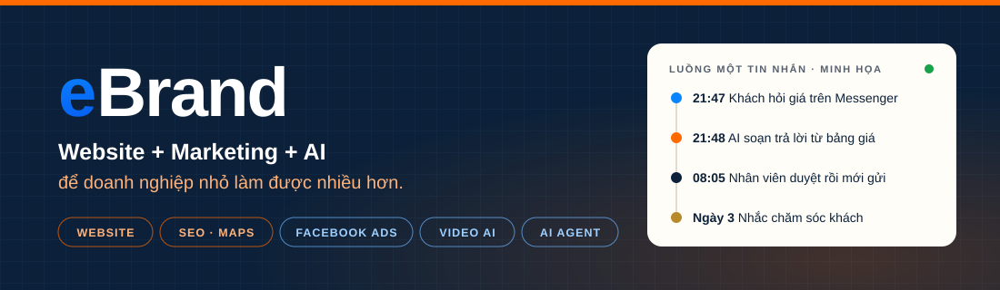
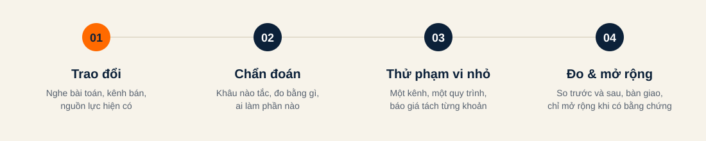

  
  
  
  

<strong>Tiếng Việt</strong> · <a href="README.en.md">English</a>

**eBrand** giúp chủ shop và doanh nghiệp nhỏ được tìm thấy, có thêm khách phù hợp và bớt việc lặp lại bằng website, marketing và AI. Chúng tôi tìm đúng khâu đang tắc trước, thử một phạm vi nhỏ, đo trước và sau, rồi mới mở rộng.

## Chúng tôi làm gì

| Mảng | Nội dung |
|---|---|
| **Website & landing page** | Website giới thiệu, landing page bán hàng, đo lượt gọi, Zalo, form; ứng dụng nội bộ nhỏ khi bảng tính không còn đủ dùng |
| **Được tìm thấy** | SEO website, SEO Google Maps, nội dung chuẩn SEO tiếng Việt |
| **Marketing & bán hàng** | Facebook Page, Facebook Ads, kịch bản tư vấn, bảng theo dõi khách và lịch chăm sóc |
| **Video bán hàng AI** | Kịch bản từ insight khách hàng, quy trình dựng với AI, một video dài thành nhiều video ngắn |
| **AI agent & tự động hóa** | Trợ lý tư vấn 24/7 từ tài liệu đã duyệt, chuyển người thật khi cần, luồng tự động có nhật ký |

**Sản phẩm AI:** eBrandAI Writer (viết nội dung SEO) · eBrandAI Skills (hỗ trợ marketing & bán hàng) · AI Sales Agent (tư vấn 24/7, thu lead, chuyển người thật khi cần).

## Vì sao chọn eBrand

- **Chẩn đoán trước, công cụ sau.** Không đề xuất mua phần mềm hay chạy thêm quảng cáo khi chưa rõ khâu nào đang tắc.
- **Thử nhỏ, đo thật.** Một kênh, một sản phẩm, một quy trình. Có số liệu nền để so sánh.
- **Báo giá tách từng khoản.** Phí triển khai, phần mềm, AI/API, duy trì, quảng cáo và công sức nội bộ ghi riêng.
- **AI có người duyệt.** Giá, cam kết và nội dung chuyên môn luôn do người có trách nhiệm xác nhận.
- **Rõ vai trò đối tác.** Khi đối tác thực hiện một phần việc, chúng tôi nói rõ ai làm, ai chịu trách nhiệm.

## Cách làm việc

1. Trao đổi để hiểu bài toán, kênh đang bán và nguồn lực hiện có
2. Chẩn đoán khâu cần xử lý trước, chỉ số cần đo và ai làm phần nào
3. Thử trên một phạm vi nhỏ, báo giá tách từng khoản
4. So sánh trước và sau, bàn giao, chỉ mở rộng khi có bằng chứng

## Phần việc công khai

Hệ thống của khách hàng được giữ private vì chứa dữ liệu và quy trình nội bộ. Các công cụ, skill AI và tài liệu dùng chung sẽ được chia sẻ dần tại đây. Kiến thức thực hành được đăng tại [ebrandagent.com](https://ebrandagent.com).

## Liên hệ

- Website: [ebrand.vn](https://ebrand.vn) · Kiến thức: [ebrandagent.com](https://ebrandagent.com)
- Email: [info@ebrand.vn](mailto:info@ebrand.vn)
- Hotline: 0908 269 673 · Zalo: 0908 688 335
- Địa chỉ: Phường Tân Đông Hiệp, TP. Hồ Chí Minh
- Giờ làm việc: Thứ 2 – Thứ 7, 08:00 – 18:00
